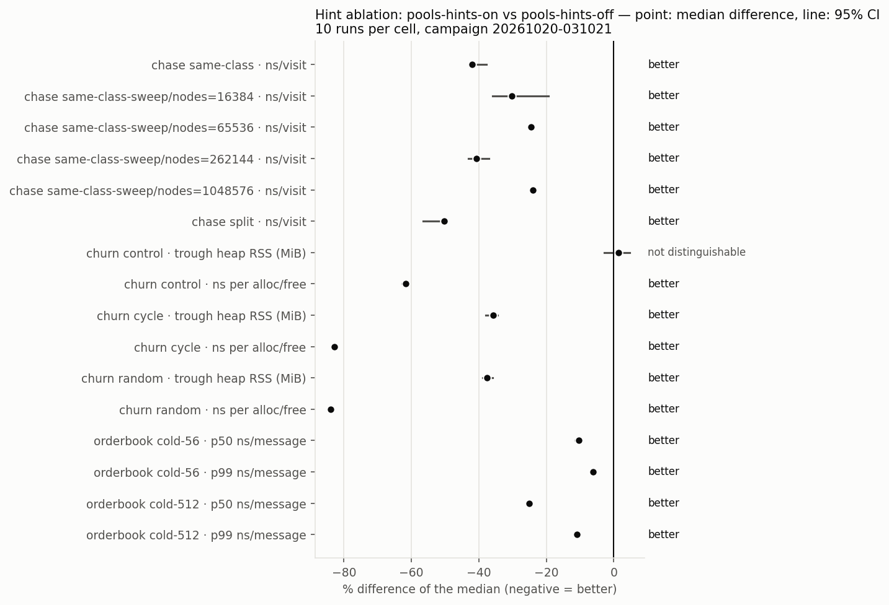
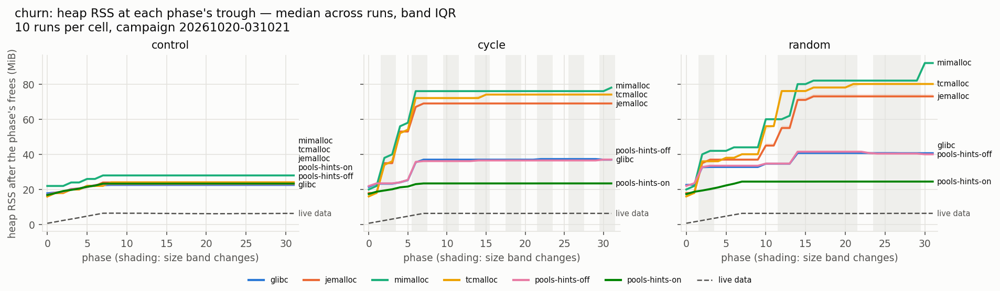
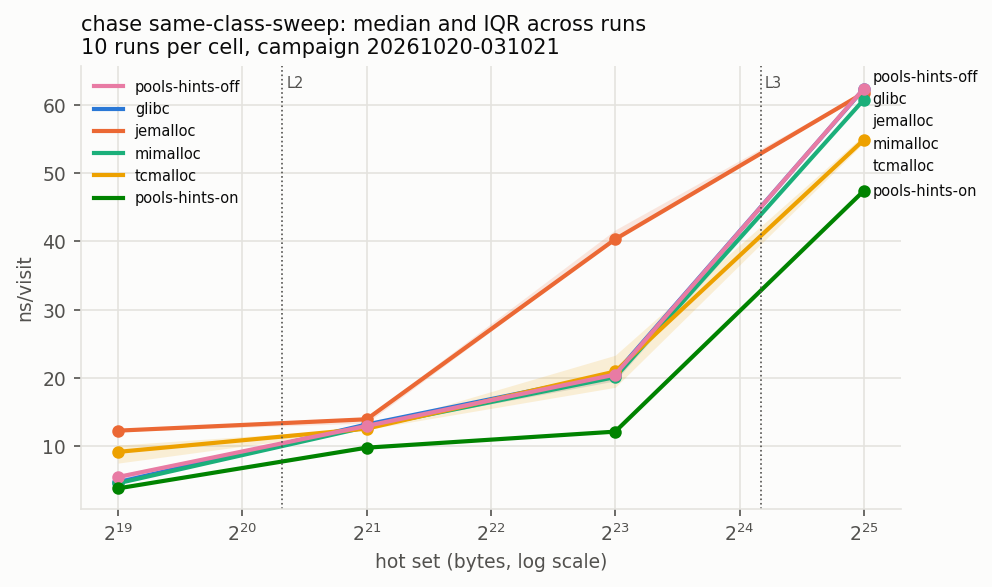

# tieralloc
tieralloc is a cross-platform single-header C++ allocator library that places objects by compile-time tier and lifetime class, that ships with an in-depth runtime memory profiler for Linux, and a concrete benchmarking suite comparing tieralloc against other industry alternatives, such as glibc, jemalloc, mimalloc, hinted tcmalloc and hand-written pools.
**hypothesis**: Knowing at compile time which objects are hot and their relative lifetimes can help in performance in two domains:
1. Packing hot objects densely reduces the hot page's footprint and dTLB misses.
2. Segregating by lifetime ensures that entire pages are emptied together, which lowers RSS and heap fragmentation.
# Progress:
- Harness and Baselines (WIP)
- Heap Profiler
- Single-header `tieralloc.hpp`
- Compile-time hints
- PEBS sampling
- Free policies
- Interactive profiler gui
- Physical addresses
- `tier::alloc_near(p)`
- Write-up
## Details
|Term|Meaning|
|:---:|:---:|
|Tier *k*| Lower index means hotter|
|Lifetime class|transient: arena-style bump allocation. persistent: free-list slot reuse.|
|Heap|One heap per (tier, lifetime) pair|
|Page depth spread| Time between first and last free of objects on a given page: low spread means that a page empties at once|
|Fragmentation Ratio|RSS/live requested bytes|
## Requirements
tieralloc: C++20
tieralloc-bench: C++23+ (concepts) - prefer C++26 to use contract assertions
Existing allocators can be built with scripts/build-allocators.sh.
# tieralloc-bench
Sample results:



## How to run
### Setup
Ideally run immediately off of a fresh boot. Set THP=always and cpupower frequency to performance. For lowest noise, also boot with `isolcpus=<cpu>`, keep sibling cores idle, and move irqs off of `<cpu>`.

---
```
scripts/bench_run.py # 1300 runs, ~15 mins depending on system
scripts/bench_summary.py results/<campaign> # summary.md, summary.csv, summary.json
scripts/bench_plot.py results/<campaign> # plots/*.svg and *.png
```
### flags
**scripts/bench_run.py**

|Flag|Default|Meaning|
|----|-------|-------|
|--matrix FILE|bench/matrix.json|which campaign to run|
|--out DIR|results/<timestamp>|output directory|
|--runs N| 10 | repetitions per cell|
|--cpu N| 10 | CPU to pin to|
|--only LIST|all|only these workloads, e.g. churn, chase|
|--dry-run||prints every command, doesnt run anything|
|--force||run despite failed requirements (noted in results)|
|--build DIR, --deps DIR|build, build-deps|where the binaries and allocators are|

**scripts/bench_summary.py**
|Flag|Meaning|
|----|-------|
|--out DIR|(summary only) write the outputs to DIR|
|--ignore-requirements|use runs made without the required THP or cpu governor; output is marked as not valid|

### running each workload seperately
Each workload is a seperate binary, one per backend. the plain uses whatever allocator is loaded with `LD_PRELOAD`.  
Ensure to run with `taskset -c <cpu>` to pin to isolated cpu!

## Requirements
Linux-based system, THP=always, cpupower frequency=performance, Linux on x86-64, GCC 16 (C++26), CMake 4, Python 3.11+, matplotlib

- The bench is built from 3 components: a workload source, a seam, and a harness.
- A workload to be benchmarked never invokes `new` or `malloc`, and are instead dispatched by the seam.
- Each allocation carries a role: one of Default, Hot, Transient, or Cold. These are standins for the hints that tieralloc will eventually take.
- Roles are defined as types and are templated, thus each call compiles to one direct path with no branching.
- The seam takes allocation and benchmarks them against each allocator configuration.
- Roles are currently dispatched to one of two backends:
  - plain ignores roles and just calls `operator new`: whatever allocator is loaded is responsible.
  - pools sends Hot objects to dense pages, transient objects to a bump arena and everything else to a fallback. This mirrors how tieralloc will function, but must be hand-tuned.
- The seam can essentially be thought of as abstracting away the exact allocator/pool to be used, and can easily be swapped out:
### example:
```cpp
struct Order { std::uint64_t id, price, qty, ts; };
// Roles can explicitly label types
Order *o1 = make<Order, Role::Cold>(...);
// the roles in a make/destroy pair must match; these are caught at runtime when contract assertions are enabled.
destroy<Order, Role::Cold>(o1);
```
- When run on the plain backend:
- `make` dispatches to the named overload:
```cpp
template <Makeable T, Role R = roleOf<std::remove_cv_t<T>>, class ... Args>
T *make(Args &&...args)
```
- and `R` is resolved as `Role::Cold` and `Args` is deduced from the arguments.
- `Makeable<T>` is a concept that checks if `T` is an object type, not an array and not abstract. 
- All of this is done at compile time; roles are invisible at runtime.
- This dispatches to `PlainBackend::allocate`, and alignment/size preconditions are checked. 
- The backend then calls `::operator new`, which gets emitted as symbol `_Znwm`. The dynamic linker then dispatches this to the preloaded allocator, and fallsback to glibc if none is supplied.
- The seam then records some stats: liveBytes, totalLiveBytes, number of allocations, and peakLiveBytes. this is the only overhead added at runtime.
- A similar process is done with `destroy`.

```cpp
// A type's role can be declared once, and inferred for subsequent uses.
template <> inline constexpr Role tabench::alloc::roleOf<Order> = Role::Hot;
Order *o2 = make<Order>(1, 100, 5, 0);
destroy(o2);

// containers can inherit roles
template <class T, tabench::alloc::Role R = tabench::alloc::roleOf<std::remove_cv_t<T>>>
using Vector = std::vector<T, tabench::alloc::Allocator<T, R>>;
Vector<Order *, Role::Hot> book;
// the allocator itself is empty as well.
static_assert(sizeof(Vector<Order *, Role::Hot>) == sizeof(std::vector<Order *>));
```
|Switch|Mechanism|Picks|
|:---:|:---:|:---:|
|Backend|Compile time: `TA_BACKEND_PLAIN` or `TA_BACKEND_POOLS` which build into seperate binaries|Who interprets roles|
|Allocator|Dynamically linked with `LD_PRELOAD`|Who serves `operator new`|
- The seam also verifies correctness and performs some simple bookkeeping (live bytes per role, allocation/free counts, and peak size)
- The harness is responsible for reporting concrete numbers. 
- Measurements for the harness comes from a Region. Each region measures (from begin->end)
  - Time elapsed, from the CPU's fixed-rate counter (TSC on x86 or `cntvct` on ARM)
  - Hardware counters: cycles, instructions, L1D, LLC, dTLB walks from a single perf group. These are read from outside of the timed window so syscall overhead is not counted.
  - Memory usage from `/proc`.
  - The CPU that ran the program is also recorded at begin and end, to ensure that unpinned runs that changed cpus is noted.
- All metrics are serialized into json.

TODO: Add info on how pool allocator works

## churn benchmark
The churn benchmarks stress test allocator free policies by inducing fragmentation: in a loop, it allocates some objects and then frees a selected subset of them. If the hypothesis were to hold, marking the survivors as long-lasting would be expected to drastically reduce RSS.
### binaries
|Binary|Backend|Use|
|:---:|:---:|:---:|
|`churn-plain`|`operator new`, i.e. whichever allocator is preloaded|glibc, jemalloc, mimalloc, tcmalloc|
|`churn-pools`|Hot pool and transient arena, glibc for rest|Config 6 (hand-written pool performance)|
|`churn-pools-checked`<br>`churn-plain-checked`|Contracts and seam checks enforced|Debug build|

Run with `taskset -c <cpu> build/bin/churn-*` to pin to a single cpu for the entire run. Allocators also have some additional configuration options available, in `build-deps/manifest.json` - note that tcmalloc requires
```
GLIB_TUNABLES=glibc.pthread.rseq=0
```
before running so it doesnt silently run without per-CPU caches. Note that this is only for plain: pools always use glibc.  

# tieralloc-trace
The heap profiler is implemented by intercepting any allocation/free calls through a layer called a shim by dynamically linking the trace backend. For simplicity, all allocation/free calls will be just called "malloc", but the same process is used for any allocations.  

Terminology:  
**Procedure Linkage table**: This is created by the static linker at build time. it contains executable stubs for function calls only. The PLT is strictly read/executable only.  
**Global Offset table**: The GOT is a fixed-size array of pointer-sized slots, written at runtime by the linker. This contains the addresses of external data and functions that are resolved eagerly at startup or lazily on first call, and is what is intercepted.

This interception relies on the fact that there is always a fixed order in which the linker performs symbol name lookup: first in the executable (which for malloc calls will (almost) always be undefined), then libraries dynamically linked via `LD_PRELOAD`, then the executable's default dependencies such as libc++, libstdc++, libc, etc. While the interception itself is quite simple by simply just defining mallocs and dynamically linking, it must still be responsible for calling the correct malloc implementation (in cases where jemalloc, mimalloc, or any other mallocs are to be used). thus, `dlsym(RTLD_NEXT, "malloc")` queries the next definition of malloc after the shim, which resolves to the actual allocator. This is held as a function pointer for future uses. For example:

[Code](https://godbolt.org/z/5eW1KK5q8)  
The emitted assembly just contains `call malloc@PLT`: The PLT stub that is created looks something like:  
```
<malloc@plt>
  endbr64
  bnd jmp QWORD PTR [rip+0x2fd5]
```
Which is a PC-relative jump into the shim's GOT slot (in this case, `rip + 0x2fd5`). The call then gets forwarded via `dlsym(...)` and returns. 

## pitfalls
While the C ABI does not have any name-mangling, the C++ Itanium ABI has mangling rules for any function call. Since the lookup is done on the exact symbol that is emitted, the forwarding must also reference the exact symbol name. For example, `operator::new` gets mangled to `_Znwm`, and thus the forwarding becomes `dlsym(RTLD_NEXT, "_Znwm")`.  
The shared binary that defines the shim also goes through its own GOT, meaning that any malloc calls, including any indirect calls (vector resizing, printf, strings, etc) get binded to the shim again, which loops infinitely. Several layers of protection are implemented to avoid this: the shim never allocates (with a small CTest to ensure that no alloc calls were emitted). However, the malloc calls themselves may also call further allocations: A depth counter is needed to ensure that nested calls only forward to the actual malloc. Some language-level runtimes may also allocate; these need to be dealt with on a case-by-case scenario.  
glibc also exposes `__libc_malloc` which calls glibc's allocator directly, skipping any interceptions.  


# interesting stuff
- x86 CPUID leaves
- Get better at TMP
- constinit vs constexpr: constexpr objects are implicitly const; e.g. when defining a compile-time atomic, need to use constinit to be mutable
## other stuff
Churn benchmark: One issue that was prevalent when implementing the churn workload benchmark (allocate/free many objects of varying sizes and lifetime to induce heap fragmentation and visualize RSS growth) was accurately showing natural RSS growth. The environment is setup so that each "run" is a seperate process - it starts with an empty heap and goes through a fixed number of **phases** (e.g. 60). Each phase:
- Frees the oldest survivors (e.g. ones created >= 8 phases ago)
- Allocates a fixed number of bytes (e.g. 64MiB)
- samples RSS at the peak
- Randomly selects most (~95%) of this phase's objects by random and frees them.
The survivors are kept and the RSS is sampled once again (phase's trough): per the hypothesis, this should ideally decrease the RSS proportional to the amount of bytes freed (assuming that objects were placed ideally). The issue with this workload is the fact that survivors pin the page that they sit on, and thus if the next phase requests similar sizes then the holes around the survivors just get filled. This was seen in a preliminary run of this workload, when all peak sizes were seen to be equal to the trough as new allocations were placed on the same page as the survivors. This ignores the point of this test: When the size changes the holes become useless as they are not big enough to to serve the new objects, and thus the allocator must request more memory. This is the overhead that is to be measured. 

The fix was quite simple; change the size of the object created per phase. two configs were added: a sawtooth config, where the band size will increase linearly up to a point and reset back to the minimum, and a random config which selects sizes by random. for General purpose allocators, we would expect the RSS to grow much larger than the portion of the heap in use (as survivors pin whole pages), whereas through lifetime segregation survivors that are explicitly tagged as long lasting are densely packed into much fewer pages.


